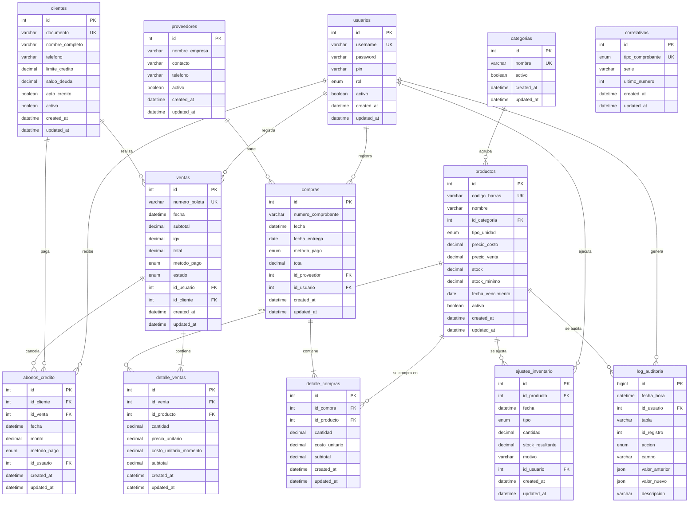

# Documento de Diseño Técnico de Base de Datos (DDD)
## Proyecto: Sistema de Ventas e Inventario para Bodega

**Versión:** 2.1 (espejo exacto del script `database/minimarket.sql` y alineado con el SRS `document/requerimientos.md` v2.1)
**Fecha:** 29/10/2026
**Motor:** MySQL 8 / MariaDB 10.4+ instalado en la máquina de caja (local, sin internet — RNF-04)
**Novedades v2.1:** Auditoría integral — `created_at` / `updated_at` en **todas** las tablas + bitácora `log_auditoria` (RF-32, RNF-08, RN-08).

---

### 1. Diagrama Entidad-Relación (DER)

El diagrama autoritativo es el siguiente (generado desde este documento):

> **Nota:** El archivo `Screenshot From 2026-09-16 15-46-15.png` de esta carpeta es el **boceto inicial** del modelo. Quedó superado por este documento: se agregaron `abonos_credito`, `ajustes_inventario`, `correlativos` y `log_auditoria`, el desglose de IGV, el estado/anulación de ventas y los campos de auditoría en todas las tablas.

---

### 2. Convenciones del Modelo

| Convención | Detalle |
| :--- | :--- |
| Motor y charset | `ENGINE=InnoDB`, `CHARSET=utf8mb4` (acentos y ñ correctos). |
| Llaves primarias | `INT AUTO_INCREMENT` en todas las tablas (`BIGINT` en `log_auditoria` por volumen). |
| Dinero | `DECIMAL(10,2)` (soles con 2 decimales). |
| Cantidades | `DECIMAL(10,3)` para soportar venta por kilogramo (RF-13). |
| **Auditoría de fechas** | **TODAS las tablas tienen `created_at` (fecha/hora de registro) y `updated_at` (fecha/hora de última modificación, se actualiza sola con `ON UPDATE CURRENT_TIMESTAMP`)** — RNF-08. |
| Fecha de negocio | `ventas.fecha`, `abonos_credito.fecha` y `ajustes_inventario.fecha` son la fecha/hora del hecho (podrían diferir de `created_at` si el registro se hace de forma diferida). |
| Baja lógica | Campos `activo BOOLEAN` en vez de `DELETE` (RN-04). |
| Borrado físico | Solo permitido en tablas de detalle cuando se anula la venta/compra completa. |
| Integridad del historial | Las FK de `producto` y `usuario` en tablas de movimiento usan `ON DELETE RESTRICT` para que nunca se pierda un histórico por borrar un registro. |
| Bitácora | `log_auditoria` es **de solo escritura** (INSERT únicamente): nunca se actualiza ni se elimina (RN-08). Por eso lleva solo `fecha_hora` y no `updated_at`. |

---

### 3. Diccionario de Datos (Especificación de Tablas)

> En todas las tablas **sin excepción** existen `created_at TIMESTAMP NOT NULL DEFAULT CURRENT_TIMESTAMP` y `updated_at TIMESTAMP NULL DEFAULT NULL ON UPDATE CURRENT_TIMESTAMP`, salvo indicación contraria. A continuación solo se detallan los campos de negocio; los campos de auditoría se listan explícitamente en cada tabla para dejarlo constado.

#### Tabla: `usuarios`
Personal con acceso al sistema y sus permisos (RF-24, RNF-01, RNF-02).
* **PK:** `id`
* **Restricciones:** `username` único; `password` solo para Administrador; `pin` solo para Cajero.

| Campo | Tipo de Dato | Restricción | Descripción |
| :--- | :--- | :--- | :--- |
| `id` | INT | PK, AUTO_INCREMENT | Identificador único del usuario. |
| `username` | VARCHAR(50) | NOT NULL, UNIQUE | Nombre para iniciar sesión. |
| `password` | VARCHAR(255) | NULL | Hash bcrypt de la contraseña — solo Administrador (RNF-01). |
| `pin` | VARCHAR(255) | NULL | Hash del código PIN — solo Cajero (RNF-02). |
| `rol` | ENUM('Administrador','Cajero') | NOT NULL | Rol en el sistema. |
| `activo` | TINYINT(1) | NOT NULL, DEFAULT 1 | Baja lógica del empleado (RF-24). |
| `created_at` | TIMESTAMP | NOT NULL, DEFAULT CURRENT_TIMESTAMP | **Auditoría:** alta en el sistema (RNF-08). |
| `updated_at` | TIMESTAMP | NULL, ON UPDATE | **Auditoría:** última modificación (RNF-08). |

---

#### Tabla: `categorias`
Grupos de productos (ej: "Lácteos"). Se creó como tabla para evitar errores de escritura en `productos.categoria`.

| Campo | Tipo de Dato | Restricción | Descripción |
| :--- | :--- | :--- | :--- |
| `id` | INT | PK, AUTO_INCREMENT | Identificador de la categoría. |
| `nombre` | VARCHAR(50) | NOT NULL, UNIQUE | Nombre del grupo. |
| `activo` | TINYINT(1) | NOT NULL, DEFAULT 1 | Baja lógica (RN-04). |
| `created_at` | TIMESTAMP | NOT NULL, DEFAULT CURRENT_TIMESTAMP | **Auditoría:** fecha/hora de creación (RNF-08). |
| `updated_at` | TIMESTAMP | NULL, ON UPDATE | **Auditoría:** fecha/hora de última edición (RNF-08). |

---

#### Tabla: `productos`
Inventario de la bodega, soportando productos por unidad o por peso (RF-11, RF-12, RF-13, RF-25).

| Campo | Tipo de Dato | Restricción | Descripción |
| :--- | :--- | :--- | :--- |
| `id` | INT | PK, AUTO_INCREMENT | Identificador único del producto. |
| `codigo_barras` | VARCHAR(50) | NULL, UNIQUE | Código escaneado (vacío si no tiene — RF-02). |
| `nombre` | VARCHAR(100) | NOT NULL | Nombre del producto (ej: "Arroz Costeño 1kg"). |
| `id_categoria` | INT | NOT NULL, FK → `categorias.id` | Categoría a la que pertenece. |
| `tipo_unidad` | ENUM('Unidad','Kilogramo') | NOT NULL, DEFAULT 'Unidad' | Se vende por unidad o por kilo (RF-13). |
| `precio_costo` | DECIMAL(10,2) | NOT NULL | Último precio al que se compró. |
| `precio_venta` | DECIMAL(10,2) | NOT NULL | Precio al público, **incluye IGV** (RN-02). |
| `stock` | DECIMAL(10,3) | NOT NULL, DEFAULT 0 | Cantidad disponible (3 decimales para kilos). |
| `stock_minimo` | DECIMAL(10,3) | NOT NULL, DEFAULT 3 | Límite para activar la alerta visual (RF-12). |
| `fecha_vencimiento` | DATE | NULL | Fecha de caducidad (vacío si no aplica — RF-20). |
| `activo` | TINYINT(1) | NOT NULL, DEFAULT 1 | Baja lógica sin perder historial (RF-25). |
| `created_at` | TIMESTAMP | NOT NULL, DEFAULT CURRENT_TIMESTAMP | **Auditoría:** alta del producto (RNF-08). |
| `updated_at` | TIMESTAMP | NULL, ON UPDATE | **Auditoría:** cambia solo al editar precio/stock (RF-25, RNF-08). |

**Índices:** `nombre` (búsqueda rápida RF-02), `stock` (alertas RF-12), `fecha_vencimiento` (vencimientos RF-20).

---

#### Tabla: `clientes`
Clientes para el control de la línea de crédito ("fiados") (RF-04, RF-05, RF-06, RF-27).

| Campo | Tipo de Dato | Restricción | Descripción |
| :--- | :--- | :--- | :--- |
| `id` | INT | PK, AUTO_INCREMENT | Identificador único del cliente. |
| `documento` | VARCHAR(15) | NULL, UNIQUE | DNI o RUC (vacío si no aporta). |
| `nombre_completo` | VARCHAR(100) | NOT NULL | Nombre y apellido del cliente. |
| `telefono` | VARCHAR(15) | NULL | Número de contacto. |
| `limite_credito` | DECIMAL(10,2) | NOT NULL, DEFAULT 0 | Monto máximo que se le puede fiar (RF-05). |
| `saldo_deuda` | DECIMAL(10,2) | NOT NULL, DEFAULT 0 | Deuda vigente; se reduce con cada abono (RF-27). |
| `apto_credito` | TINYINT(1) | NOT NULL, DEFAULT 1 | Evaluación del cliente (RF-06, RN-01). |
| `activo` | TINYINT(1) | NOT NULL, DEFAULT 1 | Baja lógica (RN-04). |
| `created_at` | TIMESTAMP | NOT NULL, DEFAULT CURRENT_TIMESTAMP | **Auditoría:** alta del cliente (RNF-08). |
| `updated_at` | TIMESTAMP | NULL, ON UPDATE | **Auditoría:** cambios de deuda/límite (RNF-08). |

---

#### Tabla: `ventas`
Cabecera de cada transacción en caja (RF-09, RF-10, RF-21, RN-07).

| Campo | Tipo de Dato | Restricción | Descripción |
| :--- | :--- | :--- | :--- |
| `id` | INT | PK, AUTO_INCREMENT | Número interno del registro. |
| `numero_boleta` | VARCHAR(20) | NOT NULL, UNIQUE | Serie y correlativo (ej: B001-000123) — RN-07. |
| `fecha` | DATETIME | NOT NULL, DEFAULT CURRENT_TIMESTAMP | **Fecha y hora del hecho** de la venta. |
| `subtotal` | DECIMAL(10,2) | NOT NULL | Base imponible (total / 1.18) — RF-03, RN-02. |
| `igv` | DECIMAL(10,2) | NOT NULL, DEFAULT 0.00 | IGV 18% desglosado (informativo). |
| `total` | DECIMAL(10,2) | NOT NULL | Monto total cobrado (subtotal + IGV). |
| `metodo_pago` | ENUM('Efectivo','Billetera Digital','Crédito') | NOT NULL | Método elegido (RF-07). |
| `estado` | ENUM('Activa','Anulada') | NOT NULL, DEFAULT 'Activa' | Estado de la boleta (RF-21). |
| `motivo_anulacion` | VARCHAR(150) | NULL | Motivo obligatorio al anular (RF-21). |
| `fecha_anulacion` | DATETIME | NULL | **Fecha y hora exacta** de la anulación (RF-21). |
| `id_usuario` | INT | NOT NULL, FK → `usuarios.id` (RESTRICT) | Cajero que realizó la venta (RF-09). |
| `id_cliente` | INT | NULL, FK → `clientes.id` (SET NULL) | Nulo si es cliente casual. |
| `id_usuario_anula` | INT | NULL, FK → `usuarios.id` (SET NULL) | Administrador que anuló (RF-21). |
| `created_at` | TIMESTAMP | NOT NULL, DEFAULT CURRENT_TIMESTAMP | **Auditoría:** cuándo se registró el registro (RNF-08). |
| `updated_at` | TIMESTAMP | NULL, ON UPDATE | **Auditoría:** cambia al anular (RNF-08). |

---

#### Tabla: `detalle_ventas`
El "carrito" de cada venta: un renglón por producto (RF-08, RF-13, RF-17).

| Campo | Tipo de Dato | Restricción | Descripción |
| :--- | :--- | :--- | :--- |
| `id` | INT | PK, AUTO_INCREMENT | Identificador del renglón. |
| `id_venta` | INT | NOT NULL, FK → `ventas.id` (CASCADE) | Venta a la que pertenece. |
| `id_producto` | INT | NOT NULL, FK → `productos.id` (RESTRICT) | Producto vendido. |
| `cantidad` | DECIMAL(10,3) | NOT NULL, CHECK > 0 | Vendida (ej: 0.500 para medio kilo). |
| `precio_unitario` | DECIMAL(10,2) | NOT NULL | Precio público con IGV en ese instante (histórico). |
| `costo_unitario_momento` | DECIMAL(10,2) | NOT NULL | **Costo histórico al vender; base de la ganancia (RF-17, RN-06).** |
| `subtotal` | DECIMAL(10,2) | NOT NULL | `cantidad × precio_unitario`. |
| `created_at` | TIMESTAMP | NOT NULL, DEFAULT CURRENT_TIMESTAMP | **Auditoría:** fecha/hora en que se agregó el renglón (RNF-08). |
| `updated_at` | TIMESTAMP | NULL, ON UPDATE | **Auditoría:** modificaciones posteriores (RNF-08). |

---

#### Tabla: `abonos_credito`
Pagos parciales que los clientes hacen contra su deuda (RF-27, RF-28).

| Campo | Tipo de Dato | Restricción | Descripción |
| :--- | :--- | :--- | :--- |
| `id` | INT | PK, AUTO_INCREMENT | Identificador del abono. |
| `id_cliente` | INT | NOT NULL, FK → `clientes.id` (RESTRICT) | Cliente que paga. |
| `id_venta` | INT | NULL, FK → `ventas.id` (SET NULL) | Boleta a crédito que está cancelando (opcional: puede abonar a deuda acumulada). |
| `fecha` | DATETIME | NOT NULL, DEFAULT CURRENT_TIMESTAMP | **Fecha y hora del pago.** |
| `monto` | DECIMAL(10,2) | NOT NULL, CHECK > 0 | Monto abonado. |
| `metodo_pago` | ENUM('Efectivo','Billetera Digital') | NOT NULL | Cómo pagó (RF-07). |
| `id_usuario` | INT | NOT NULL, FK → `usuarios.id` (RESTRICT) | Quién registró el abono. |
| `observacion` | VARCHAR(150) | NULL | Nota libre. |
| `created_at` | TIMESTAMP | NOT NULL, DEFAULT CURRENT_TIMESTAMP | **Auditoría:** fecha/hora de registro (RNF-08). |
| `updated_at` | TIMESTAMP | NULL, ON UPDATE | **Auditoría:** correcciones (RNF-08). |

---

#### Tabla: `proveedores`
Empresas o distribuidores que surten a la bodega (RF-14, RF-29).

| Campo | Tipo de Dato | Restricción | Descripción |
| :--- | :--- | :--- | :--- |
| `id` | INT | PK, AUTO_INCREMENT | Identificador de la empresa. |
| `nombre_empresa` | VARCHAR(100) | NOT NULL | Nombre de la empresa (RF-14). |
| `contacto` | VARCHAR(100) | NULL | Nombre y apellido del contacto. |
| `telefono` | VARCHAR(15) | NULL | Número de contacto. |
| `activo` | TINYINT(1) | NOT NULL, DEFAULT 1 | Baja lógica sin perder historial (RF-29). |
| `created_at` | TIMESTAMP | NOT NULL, DEFAULT CURRENT_TIMESTAMP | **Auditoría:** alta del proveedor (RNF-08). |
| `updated_at` | TIMESTAMP | NULL, ON UPDATE | **Auditoría:** edición (RNF-08). |

> **Corrección respecto a la versión 1.0:** los campos `fecha_entrega` y `fecha_visita` se **eliminaron** de aquí: no son atributos del proveedor sino de cada compra/pedido. `fecha_entrega` ahora vive en `compras`.

---

#### Tabla: `compras`
Factura o nota de entrega del proveedor (RF-15, RF-16).

| Campo | Tipo de Dato | Restricción | Descripción |
| :--- | :--- | :--- | :--- |
| `id` | INT | PK, AUTO_INCREMENT | Registro interno de la compra. |
| `numero_comprobante` | VARCHAR(50) | NULL | N° de factura o boleta física del proveedor (RF-15). |
| `fecha` | DATETIME | NOT NULL, DEFAULT CURRENT_TIMESTAMP | **Fecha y hora del hecho:** cuándo se ingresó la mercadería. |
| `fecha_entrega` | DATE | NULL | Fecha de entrega pactada con el proveedor (RF-15). |
| `metodo_pago` | ENUM('Efectivo','Billetera Digital','Crédito') | NOT NULL | Cómo se pagó la compra (RF-15). |
| `total` | DECIMAL(10,2) | NOT NULL | Monto total invertido. |
| `id_proveedor` | INT | NOT NULL, FK → `proveedores.id` (RESTRICT) | Proveedor que vendió (RF-14). |
| `id_usuario` | INT | NULL, FK → `usuarios.id` (SET NULL) | Administrador que la registró. |
| `created_at` | TIMESTAMP | NOT NULL, DEFAULT CURRENT_TIMESTAMP | **Auditoría:** fecha/hora de registro (RNF-08). |
| `updated_at` | TIMESTAMP | NULL, ON UPDATE | **Auditoría:** correcciones (RNF-08). |

---

#### Tabla: `detalle_compras`
Desglose de productos de cada compra.

| Campo | Tipo de Dato | Restricción | Descripción |
| :--- | :--- | :--- | :--- |
| `id` | INT | PK, AUTO_INCREMENT | Identificador del renglón. |
| `id_compra` | INT | NOT NULL, FK → `compras.id` (CASCADE) | Compra a la que pertenece. |
| `id_producto` | INT | NOT NULL, FK → `productos.id` (RESTRICT) | Producto comprado. |
| `cantidad` | DECIMAL(10,3) | NOT NULL, CHECK > 0 | Cantidad comprada; suma al stock (RF-16). |
| `costo_unitario` | DECIMAL(10,2) | NOT NULL | Precio de compra histórico en ese instante. |
| `subtotal` | DECIMAL(10,2) | NOT NULL | `cantidad × costo_unitario`. |
| `created_at` | TIMESTAMP | NOT NULL, DEFAULT CURRENT_TIMESTAMP | **Auditoría:** fecha/hora de registro (RNF-08). |
| `updated_at` | TIMESTAMP | NULL, ON UPDATE | **Auditoría:** correcciones (RNF-08). |

---

#### Tabla: `ajustes_inventario`
Trazabilidad de ajustes de stock: merma, daño, vencimiento o conteo físico (RF-26).

| Campo | Tipo de Dato | Restricción | Descripción |
| :--- | :--- | :--- | :--- |
| `id` | INT | PK, AUTO_INCREMENT | Identificador del ajuste. |
| `fecha` | DATETIME | NOT NULL, DEFAULT CURRENT_TIMESTAMP | **Fecha y hora del hecho** del ajuste. |
| `id_producto` | INT | NOT NULL, FK → `productos.id` (RESTRICT) | Producto ajustado. |
| `tipo` | ENUM('Merma','Daño','Vencimiento','Conteo físico','Otro') | NOT NULL | Motivo clasificado (RF-26). |
| `cantidad` | DECIMAL(10,3) | NOT NULL, CHECK ≠ 0 | **Negativa resta** stock, **positiva suma**. |
| `stock_resultante` | DECIMAL(10,3) | NOT NULL | Stock luego del ajuste (control cruzado). |
| `motivo` | VARCHAR(150) | NOT NULL | Descripción obligatoria del porqué (RF-26). |
| `id_usuario` | INT | NOT NULL, FK → `usuarios.id` (RESTRICT) | Quién ejecutó el ajuste. |
| `created_at` | TIMESTAMP | NOT NULL, DEFAULT CURRENT_TIMESTAMP | **Auditoría:** fecha/hora de registro (RNF-08). |
| `updated_at` | TIMESTAMP | NULL, ON UPDATE | **Auditoría:** correcciones (RNF-08). |

---

#### Tabla: `correlativos`
Control automático de la numeración de comprobantes que emite el sistema (RN-07).

| Campo | Tipo de Dato | Restricción | Descripción |
| :--- | :--- | :--- | :--- |
| `id` | INT | PK, AUTO_INCREMENT | Identificador. |
| `tipo_comprobante` | ENUM('Boleta','Factura') | NOT NULL, UNIQUE | Tipo de comprobante. |
| `serie` | VARCHAR(10) | NOT NULL | Serie (ej: B001). |
| `ultimo_numero` | INT | NOT NULL, DEFAULT 0 | Último correlativo emitido; se incrementa con cada venta. |
| `created_at` | TIMESTAMP | NOT NULL, DEFAULT CURRENT_TIMESTAMP | **Auditoría:** creación de la serie (RNF-08). |
| `updated_at` | TIMESTAMP | NULL, ON UPDATE | **Auditoría:** cambia con cada boleta emitida (RNF-08). |

---

#### Tabla: `log_auditoria` ⭐ NUEVA EN v2.1
Bitácora central de auditoría: registra **quién, cuándo, qué y cómo cambió** cada dato sensible del sistema (RF-32, RN-08, RNF-08). Es **de solo escritura**: nunca se actualiza ni se elimina.

| Campo | Tipo de Dato | Restricción | Descripción |
| :--- | :--- | :--- | :--- |
| `id` | BIGINT | PK, AUTO_INCREMENT | Identificador del evento (alto volumen, por eso BIGINT). |
| `fecha_hora` | DATETIME | NOT NULL, DEFAULT CURRENT_TIMESTAMP | **Fecha y hora exacta** del cambio (RF-32). |
| `id_usuario` | INT | NULL, FK → `usuarios.id` (SET NULL) | Autor del cambio; NULL si lo hizo el propio sistema. |
| `tabla` | VARCHAR(30) | NOT NULL | Tabla afectada (ej: `productos`, `ventas`). |
| `id_registro` | INT | NULL | PK del registro afectado. |
| `accion` | ENUM('INSERT','UPDATE','DELETE') | NOT NULL | Tipo de acción. |
| `campo` | VARCHAR(50) | NULL | Campo puntual cuando el cambio fue de un solo campo (ej: `precio_venta`). |
| `valor_anterior` | JSON | NULL | Valores previos del registro (antes del cambio). |
| `valor_nuevo` | JSON | NULL | Valores posteriores del registro (después del cambio). |
| `descripcion` | VARCHAR(255) | NULL | Resumen legible (ej: "Precio de venta de Arroz Costeño: S/ 3.50 → S/ 3.80"). |

**Índices:** `fecha_hora` (filtros por rango), `tabla`, `id_usuario`, (`tabla`,`id_registro`) para reconstruir la historia completa de un registro.

**Eventos que DEBEN quedar registrados (RF-32):**

| Evento | `tabla` | `accion` |
| :--- | :--- | :--- |
| Alta de producto/cliente/proveedor/categoría/usuario | la tabla correspondiente | `INSERT` |
| Cambio de precios, stock o datos maestros | la tabla correspondiente | `UPDATE` |
| Venta registrada | `ventas` + `detalle_ventas` | `INSERT` |
| Venta anulada | `ventas` | `UPDATE` (con motivo y valores antes/después) |
| Compra registrada | `compras` + `detalle_compras` | `INSERT` |
| Abono de crédito | `abonos_credito` + `clientes` (`saldo_deuda`) | `INSERT` / `UPDATE` |
| Ajuste de inventario | `ajustes_inventario` + `productos` (`stock`) | `INSERT` / `UPDATE` |
| Baja lógica (`activo = false`) | la tabla correspondiente | `UPDATE` |

---

### 4. Reglas de Integridad y Transacciones

1. **Registrar venta (RN-05):** en una sola transacción → insertar `ventas` + N `detalle_ventas` + restar `productos.stock` + sumar `clientes.saldo_deuda` (si es Crédito) + incrementar `correlativos.ultimo_numero` + **registrar el evento en `log_auditoria`**.
2. **Registrar compra:** en una sola transacción → insertar `compras` + N `detalle_compras` + sumar `productos.stock` + actualizar `productos.precio_costo` con el nuevo costo + **bitácora**.
3. **Registrar abono:** en una sola transacción → insertar `abonos_credito` + restar `clientes.saldo_deuda` (validando que no quede negativa, RF-27) + **bitácora con saldo antes/después**.
4. **Anular venta (RF-21):** cambiar `estado` a 'Anulada' + sumar de vuelta el stock + restar `saldo_deuda` si era a crédito + **bitácora con `id_usuario_anula`, motivo y fecha**.
5. **Ajuste de inventario (RF-26):** insertar en `ajustes_inventario` + modificar `productos.stock` usando el mismo `stock_resultante` guardado + **bitácora**.
6. **Avisos de integridad:** las operaciones 1 a 5 deben ejecutarse desde el backend dentro de una conexión transaccional; si una parte falla, se hace `ROLLBACK` completo (la bitácora se revierte junto con el cambio, porque se escribe en la misma transacción).
7. **Auditoría (RN-08):** cada operación anterior escribe su fila en `log_auditoria` **dentro de la misma transacción**, capturando el usuario de la sesión activa. La bitácora no expone acciones de edición ni borrado (`UPDATE`/`DELETE`) en la interfaz del Cajero.

---

### 5. Datos Semilla (incluidos en el script SQL)

*   **Categorías:** Abarrotes, Bebidas, Lácteos, Limpieza, Snacks.
*   **Correlativo inicial:** Serie `B001` para Boletas, contador en 0.
*   **Usuarios:** el script **no siembra ningún usuario con contraseña** por seguridad. El primer Administrador se crea en la primera ejecución del sistema (asistente de instalación — RF-24). Al crearse, ese evento ya queda registrado en `log_auditoria`.
*   **`log_auditoria`:** sin datos iniciales; solo se llena con el uso del sistema.
